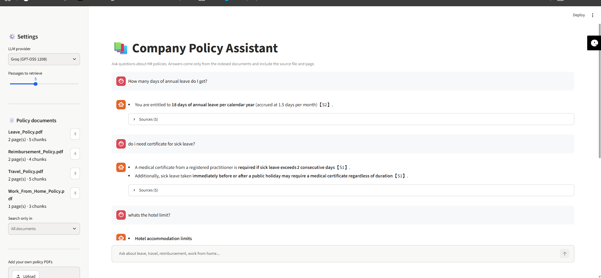
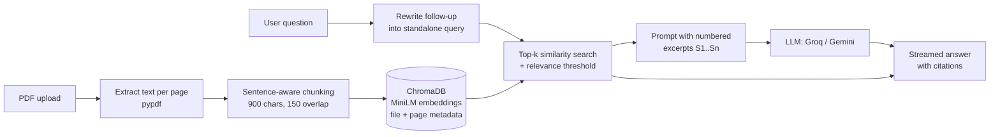

# 📚 Company Policy Assistant

A Retrieval-Augmented Generation (RAG) chatbot that answers employee questions about HR policies (leave, travel, reimbursement, work from home) **using only the company's own documents**, and shows the **source file and page** for every answer.

Upload your policy PDFs, ask questions in plain English, and get grounded, cited answers instead of searching through long documents.



## Features

- **Grounded answers with citations**: inline `[S1]` markers plus an expandable source panel with file name, page number, match score and the exact passage.
- **Multi-PDF knowledge base** stored in ChromaDB, with the file name and page as metadata.
- **Conversation-aware**: follow-ups like *"what about managers?"* are rewritten into standalone search queries before retrieval.
- **Hallucination guard**: irrelevant questions are refused without calling the LLM, and the prompt forces the model to say when the answer is not in the documents.
- **Prompt-injection hardening**: retrieved text is treated as untrusted data.
- **Streaming responses** and a clean Streamlit chat UI.
- **Document management**: upload, re-index (duplicates are skipped by content hash), delete, and restrict a search to selected files.
- **Two free LLM providers**: Groq (GPT-OSS 120B) and Google Gemini 2.5 Flash. Switch in the sidebar.
- **Runs locally and free**: embeddings use ChromaDB's bundled ONNX MiniLM model (no PyTorch, no embedding API key).
- **Engineering quality**: modular package, 30+ automated tests, retrieval evaluation script, GitHub Actions CI, Dockerfile.

## Architecture



## Tech stack

| Layer | Choice |
|---|---|
| UI | Streamlit |
| Vector DB | ChromaDB (persistent, cosine similarity) |
| Embeddings | all-MiniLM-L6-v2 (ONNX, local, CPU) |
| LLMs | Groq `llama-3.3-70b-versatile`, Google `gemini-2.5-flash` |
| PDF parsing | pypdf |
| Testing / CI | pytest, GitHub Actions |
| Packaging | Docker |

## Quick start

```bash
git clone https://github.com/<your-username>/company-policy-assistant.git
cd company-policy-assistant

python -m venv venv
source venv/bin/activate        # Windows: venv\Scripts\activate
pip install -r requirements.txt

cp .env.example .env            # Windows: copy .env.example .env
# edit .env and paste ONE free API key (see below)

streamlit run app.py
```

The first launch downloads the ~80 MB embedding model once and indexes the four sample policies in `data/policies/`.

**Free API keys (no credit card):**
- Groq: https://console.groq.com/keys
- Gemini: https://aistudio.google.com/apikey

You can also skip `.env` and paste the key into the app sidebar. It stays in the browser session only.

## Using your own documents

Upload PDFs from the sidebar, or run `python scripts/ingest.py path/to/folder`. Scanned (image-only) PDFs need OCR first; the app tells you when a PDF has no extractable text.

## Configuration

All settings are environment variables (see `.env.example`).

| Variable | Default | Purpose |
|---|---|---|
| `LLM_PROVIDER` | `groq` | Default provider (`groq` or `gemini`) |
| `CHUNK_SIZE` / `CHUNK_OVERLAP` | `900` / `150` | Chunking in characters |
| `TOP_K` | `5` | Passages sent to the LLM |
| `MAX_DISTANCE` | `0.80` | Cosine-distance cut-off; lower is stricter |
| `CHROMA_DIR` | `./chroma_db` | Where the vector DB is stored |

## Testing and evaluation

```bash
pip install -r requirements-dev.txt
python -m pytest                 # unit + integration + UI smoke tests (no API key or network needed)
python scripts/evaluate.py       # retrieval quality on 16 labelled questions
```

`evaluate.py` reports **Source hit@k**, **Answer hit@k** and **MRR** using the real embedding model. Run it yourself and record your numbers here:

| Metric (k=3) | Result |
|---|---|
| Source hit@3 | 100.0% |
| Answer hit@3 | 100.0% |
| MRR | 0.938 |

## Deployment

**Streamlit Community Cloud (free, easiest)**
1. Push this repo to GitHub (public).
2. Go to https://share.streamlit.io, click **New app**, pick the repo, main file `app.py`.
3. In **Advanced settings → Secrets** add: `GROQ_API_KEY = "your-key"`.
4. Deploy and put the URL in this README and your portfolio.

**Hugging Face Spaces**: create a Docker Space, push this repo, and add `GROQ_API_KEY` as a Space secret (set `app_port: 8501` in the Space README metadata).

**Docker**
```bash
docker build -t policy-assistant .
docker run -p 8501:8501 -e GROQ_API_KEY=your-key policy-assistant
```

Note: free hosts have ephemeral disks, so uploaded documents disappear on restart. The sample policies are re-indexed automatically.

## Project structure

```
company-policy-assistant/
├── app.py                      # Streamlit UI
├── policy_assistant/
│   ├── config.py               # Settings from environment
│   ├── ingestion.py            # PDF extraction + chunking
│   ├── vectorstore.py          # ChromaDB wrapper (add/query/delete/list)
│   ├── indexer.py              # Index files and folders (dedupe by hash)
│   ├── llm.py                  # Groq and Gemini clients (stream + complete)
│   └── rag.py                  # Query rewrite, retrieval, prompts, answer
├── scripts/
│   ├── generate_sample_policies.py
│   ├── ingest.py
│   └── evaluate.py
├── data/policies/              # 4 fictional sample policy PDFs
├── data/eval_questions.json    # labelled retrieval test set
├── tests/                      # pytest suite
├── Dockerfile
└── .github/workflows/ci.yml
```

## Design decisions

- **Page-bounded chunks** so every citation has an exact page number.
- **Cosine distance + threshold** so the bot refuses off-topic questions instead of guessing.
- **Query rewriting** because follow-up questions retrieve poorly when embedded as-is.
- **No LangChain**: a small amount of explicit code keeps the pipeline easy to read, test and debug.
- **Local ONNX embeddings** keep the app free, private and light enough for free hosting.

## Limitations and future work

- No OCR for scanned PDFs (could add Tesseract).
- Semantic search only; adding BM25 hybrid search and a cross-encoder re-ranker would improve exact-term lookups.
- No user authentication or per-role document access.
- Tables inside PDFs are extracted as plain text.

## Disclaimer

The sample policies are fictional. Answers are AI-generated and can be wrong; confirm important decisions with HR.

## License

MIT
